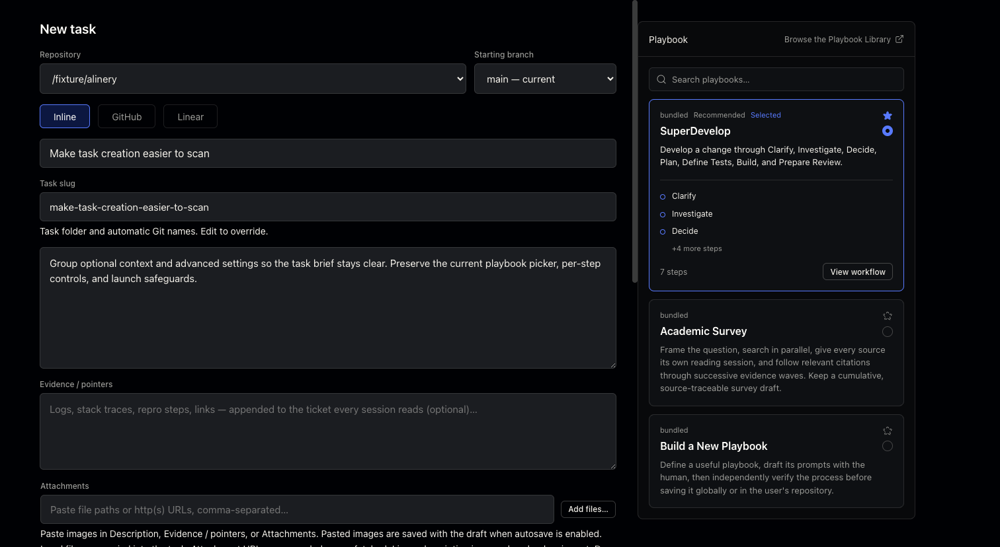
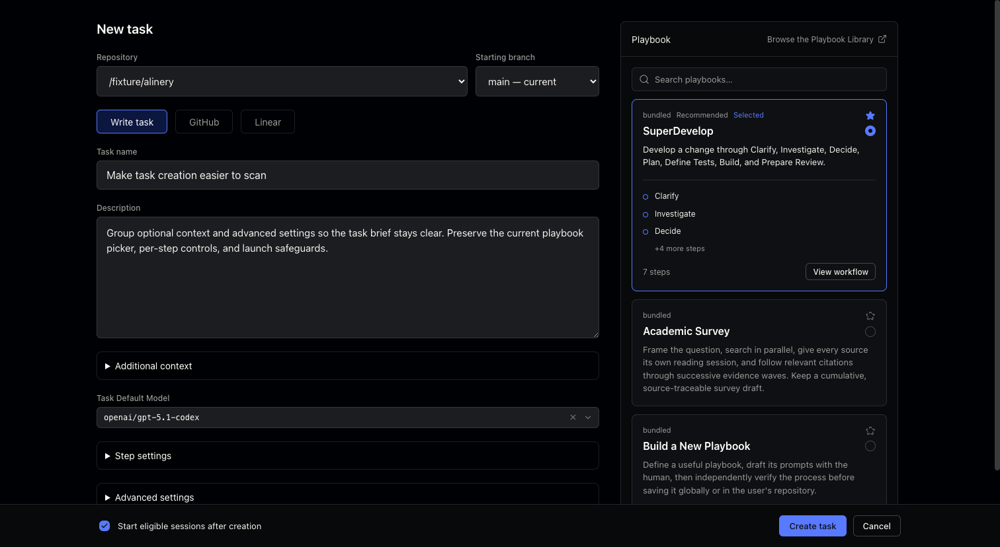
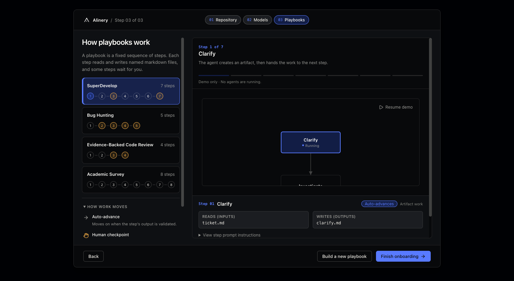
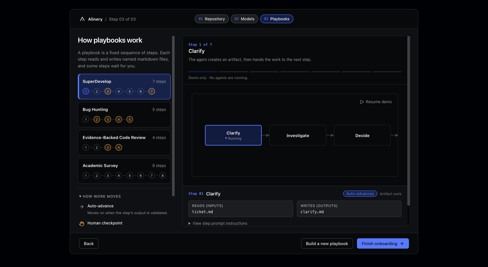
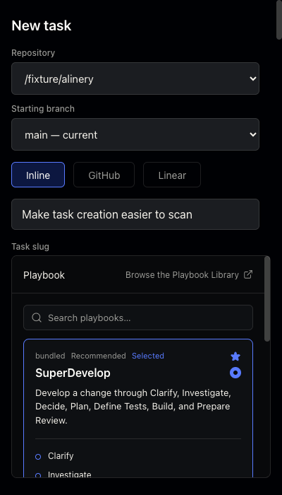
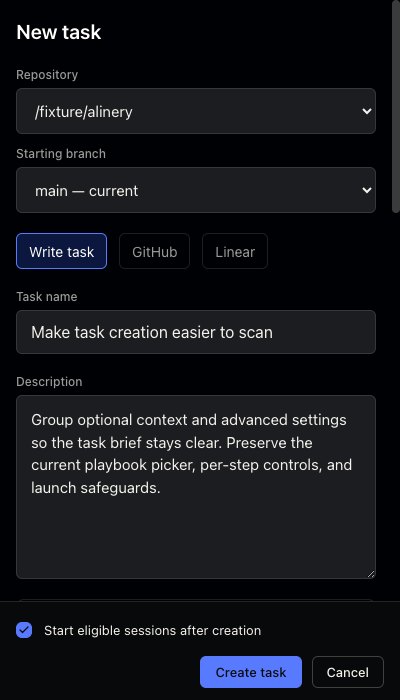
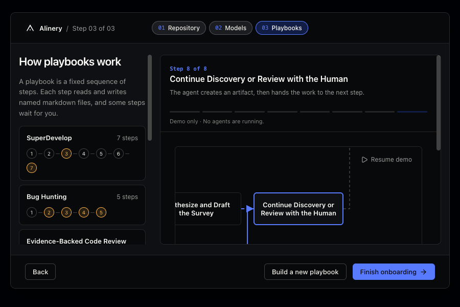

# PR #155 — redo on current main

This preserves main's searchable, starred playbook picker, workflow viewer, continuation controls, guided onboarding demo and inspector. It carries forward the remaining New Task layout and horizontal onboarding flow rather than replaying the old branch over those rewrites.

## Browser evidence

Captured from actual React components in Chromium on November 4, 2026. No desktop app was launched. The before revision is `693cabaa7e74710276ecb792cf9d9d8881a296bf`; after is the code in this PR.

An isolated Vite preview imports the source components and their CSS. The before tree is extracted with `git archive` from the immutable main revision. Both versions use the same explicit IPC fixtures: one repository (`/fixture/alinery`), a `main` starting branch, the bundled playbook definitions, a sample task brief and model selection, and no signed-in account. Native calls are intercepted; unexpected calls fail visibly. These are genuine rendered frontend screenshots, not desktop/native-integration evidence. They do not verify authentication, filesystem attachment copies, or session launch. No real agents run in the onboarding demo.

The desktop pairs use a 1512 × 828 CSS-pixel viewport, device scale factor 1 and UI scale 1. The onboarding demo is paused on the first step of SuperDevelop for both versions. The narrow pair uses 400 × 700 with identical content and scale.

### New Task

Before:

After:

### Onboarding

Before:

After:

### Narrow New Task

Before:

After:

### Constrained horizontal flow

At 900 × 600, the Academic Survey's final node starts beyond the 482-pixel graph viewport. Selecting it brings the whole node into view without moving an already-visible target unnecessarily. This capture shows the resulting final-step inspection state:

## Behavior checked

- Horizontal simulation targets are revealed when offscreen; already-visible targets stay still. Onboarding keeps main's readable 1× zoom floor rather than shrinking text into an unreadable overview.
- Automatic-fit cameras follow viewport shrink. Manual zoom, pan, wheel and actual-size/reset retain scale and the world-space focal point; explicit Fit restores automatic fitting.
- Additional context opens for incoming evidence, attachments, images and new errors, including asynchronous draft-load and image-preview errors. A new failed paste/import attempt is revealed even if its error message is identical. Editing, removing content and unrelated renders do not repeatedly override a manual collapse.
- Step settings retain main's existing continuation choices inside a native disclosure.
- Invalid restored session limits reveal Advanced settings, without continually reopening it after a manual collapse.
- Source buttons expose their selected state, and import inputs have associated labels.
- Browser geometry checks at 320, 400, 900 and 1512 pixels found no horizontal form overflow; footer actions remain inside the viewport. Delayed file-picker results reveal Additional context, and a subsequent manual collapse survives editing.
- Final paired captures recorded no console errors, uncaught errors, unhandled rejections or unexpected IPC calls.

Focused regressions cover the camera/disclosure state transitions plus horizontal fan-out, return paths, custom heights and unchanged labeled dependency layout. Local test logs and the original dirty-worktree backup are retained separately, not bundled as product source.
